# History Crash 기획안

현대 판타지 배경의 감염된 건물/인물을 공략하는 게임

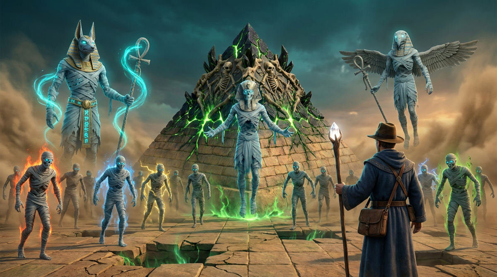

*메인 썸네일*

## 1. 레퍼런스

### 재미요소

- 패리맨 (오브젝트와 상호작용)

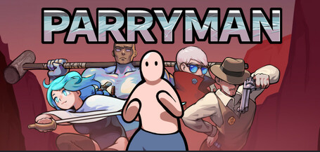

*재미요소 레퍼런스: 패리맨*

### 조작요소

- 엔터 더 건전: 고정된 보스의 탄막 액션
- 키보드/마우스를 이용한 조작

*조작요소 레퍼런스: 엔터 더 건전*

### 세계관

- 스타크래프트: 감염된 건물

*세계관 레퍼런스: 스타크래프트*

## 2. 세계관

- 현대 판타지 배경
- 감염된 건물과 인물을 공략하는 구조

## 3. 핵심 재미

- 기믹형 보스(건물)의 패턴 공략
- 보스의 공격을 보스에게 되돌려 사용 (Use the boss's attack against it)

## 4. 공략 방법

- 기믹을 파훼하며 진행
- 되살아난 문화적 인물을 변이시켜 몹으로 만듦
- 미라를 처치하면 파티클이 생기고, 파티클이 파라오에게 데미지를 줌

## 5. 보스 기믹 정리

### 5-1. 파라오 (이집트 테마) · 건물: 피라미드

- 모래바람으로 화면을 가림
  - 모래를 이용한 패턴 공격
  - 참고 링크: <https://blog.naver.com/yuhojun123/40177001788>
- 몬스터 소환: 미라, 아누비스, 호루스
  - 미라: 파라오 앞에서 리젠, 체력 100, 접촉 시 플레이어에게 1 데미지, 처치 시 파라오에게 파티클 데미지
  - 아누비스·호루스: 데미지 없이 방해 오브젝트로 작용
    - 아누비스: 25초마다 플레이어를 '아누비스 앞'으로 강제 이동시키는 방해 기믹 전담 (이동위치 사전 경고 표시 제거로 기습성 향상, 강제 이동 진행 중 무적 판정 및 이동 완료 직후 0.5초 무적 추가 부여).
    - 호루스: 랜덤 타일 7개를 소멸 3초 전 붉은 워닝 표시 후 10초 동안 소멸
    - 소멸 타일에 빠진 플레이어는 낙하 연출 후 2 데미지, 초기 위치로 복귀하며 무적 적용
    - 소멸된 타일 영역에서는 플레이어 및 몬스터 모두 이동 불가 (소멸 모션 및 파티클 연출)
- 보스 패턴 전개 직후 무작위 위치에 스태프(지팡이)가 드랍되어, 플레이어가 이를 재활용 시 보스의 해당 공격 패턴과 동일/유사한 이펙트 및 판정 효과가 발동함 (속성 조합 시 해당 속성에 맞는 전용 파티클 이펙트 추가 부여 / A: 부메랑 탄막, B: 스파이크 근접, C: 오브 3개 확산, D: 메테오 범위, E: 검 스나이핑)
  - 보스 패턴 시전 및 스태프 드랍 규칙: 보스가 5개 패턴 중 1개를 랜덤 사이클로 선택하여 시전하며, 이때 각 패턴의 시전 비율은 2:3:1:2:2 (A 부메랑 탄막: 2 · B 스파이크 근접: 3 · C 오브3개 확산: 1 · D 메테오 범위: 2 · E 검 스나이핑: 2)로 적용됨. 보스가 패턴을 시전하면 해당 시전 패턴에 대응하는 스태프가 필드 무작위 위치에 드랍되어 플레이어가 보스 공격을 재활용할 수 있음.

*아누비스 드랍템(지팡이) 참고 이미지*

- 소환된 미라 (속성 아이템 드랍): 리젠 시 4가지 속성(불 25% · 물 25% · 전기 25% · 풀 25%)이 동률로 무작위 부여되며, 붕대/눈빛 테마 색상과 전용 파티클 효과로 가시성을 향상함. 미라가 3초 주기(기존 7초/5초에서 단축)로 본인의 고유 속성과 동일한 오브(속성 아이템)를 드랍.

*미라 드랍템(속성 아이템) 참고 이미지*

### 5-1-0. 신규 연출, 비주얼 및 장비 시스템 개편 사항

- 스태프 & 오브 장착 메커니즘 개편: 드랍 오브젝트 모델링 변경 적용. 플레이어가 획득한 오브(속성 아이템)에 따라 소지하는 형태로 변경되며, Staff + Orb 결합 방식으로 Staff 중앙부의 빈 공간에 Orb가 결합/삽입되는 형태 연출. (스태프의 디스폰 시간은 전면 제거되어 획득 전까지 필드에 영구 유지됨).
- 시전 애니메이션 및 조작 규칙: 플레이어 공격 시전 시 전용 애니메이션 추가 (애니메이션 진행 동안 짧은 시전 시간 동안 이동 정지). 파라오 보스는 패턴 전개 시 고유 전용 애니메이션 동작 수행.
- 미라 사망 연출 강화: 미라 사망 시 전용 모션/애니메이션 추가. 미라 처치 시 미라 내부의 속성 오브가 튀어나와 파라오에게 직격하는 피격 연출로 시각적 쾌감 강화.
- 아누비스 강제 이동 기믹 개선: 아누비스의 이동 위치 확인(사전 워닝 장판 표시)을 제거하여 플레이의 긴장감 부여. 강제 이동 기믹 진행 중에는 무적 상태 유지 및 이동 완료 후 0.5초간 추가 무적 부여.
- 배경 및 밸런스: 여백 공간에 자연스러운 전용 배경 오브젝트 배치 완료, 전체 전투 난이도 및 밸런스 조정 완료.

### 5-1-1. 파훼 시 정화

- 보스(파라오)를 파훼하면 정화 연출로 전환
- 언데드화된 피라미드가 디폴트 형태로 복원
- 소환 몹(미라, 아누비스, 호루스) 소멸, 모래바람 해제

### 5-1-2. 스테이터스 (파라오 기준)

| 항목 | 값 | 비고 |
| --- | --- | --- |
| 파라오 총 HP | 1,200 | 플레이어는 직접 공격하지 않음 |
| 미라 1킬 파티클 피해 | 20 | 파라오에게 전달 |
| 필요 킬 수 | 60 | 1200 ÷ 20 |
| 미라 체력 | 100 | 1킬 무기 ≥100 피해, 2킬 무기 1발 50 |
| 미라 접촉 피해 | 1 | 플레이어에게 부딪힐 때 |
| 파라오 크기 | 1타일 | 호루스·아누비스와 동일 |
| 소환 몹 이동속도 | 1.5 타일/초 | 플레이어의 절반 (미라·호루스·아누비스) |
| 호루스·아누비스 | 데미지 없음 | 방해 오브젝트로 작용. 아누비스 사전 이동경고 제거, 강제이동 중 무적 + 도착 후 0.5초 무적 부여 |
| 소멸 타일 낙하 피해 | 2 | 낙하 연출 후, 초기 위치로 복귀 + 무적 |
| 목표 플레이 타임 | 스피드런 10분 / 일반 15분 | 스피드런은 최적화 플레이, 일반은 여유 있는 플레이 |
| 미라 리젠 | 분당 6마리, 파라오 앞 | 10분 기준 총 60마리 등장 |
| 공격 방식 | 지팡이 + 속성 아이템 | 스태프 + 속성 아이템 조합 1회 = 공격 1회 (보스 패턴과 유사한 메커니즘/이펙트 사용 및 속성별 전용 파티클 연출 부여) |
| 플레이어 HP | 하트 5칸 | 피격 후 무적 1초, 깜빡임 표시 |
| 플레이어 피격 판정 | 0.7 타일 | 시각 크기 0.6보다 약간 크게 |
| 속성 아이템 드랍률 | 각 25% | 불·물·전기·풀 동률 |
| 보스 패턴 시전 비율 & 스태프 드랍 | 2:3:1:2:2 (랜덤 사이클) | 보스가 랜덤 사이클로 패턴 시전 시 비율 2:3:1:2:2 적용 (A 부메랑 2 · B 스파이크 3 · C 오브3개 1 · D 메테오 2 · E 검 2). 시전된 패턴에 부합하는 스태프가 필드 무작위 위치에 확정 드랍됨 |
| 속성 아이템 드랍 방식 | 3초 주기로 미라 드랍 (기존 7초/5초 → 3초 단축) | 소환된 미라가 생성 시 무작위 속성(불·물·전기·풀 각 25%) 부여받음. 3초 주기로 본인 고유 속성과 동일한 오브(속성 아이템)를 드랍 |
| 드랍물 유지 시간 (디스폰 규칙) | 스태프: 무제한 (디스폰 제거) / 속성 오브: 12초 | 필드에 드랍된 스태프는 디스폰 시간(기존 12초)을 제거하여 플레이어가 획득할 때까지 영구 유지됨. 미라가 드랍하는 속성 오브는 12초간 유지 후 미획득 시 소멸. |
| 전투 바닥 | 1×1 타일 16×12 | 플랫 타일, 기본 스케일 1 (기존 8×6에서 확대) |
| 플레이어 이동속도 | 3.0 타일/초 | 대각선은 0.707배, 가속·감속 0.1초 |
| 플레이어 크기 | 0.6 타일 | 탑뷰 기준 |
| 미라 크기 | 0.6 타일 | 플레이어와 동일 비율 |
| 미라 판정 범위 | 약 0.7타일 | 시각 크기보다 약간 크게, 형태는 동일 |
| 호루스·아누비스 크기 | 타일 1칸 | 방해 오브젝트로 작용. 아누비스 사전 이동경고 제거, 강제이동 중 무적 + 도착 후 0.5초 무적 부여 |

### 5-1-3. 파라오 탄막 (참고: 크로커다일 사막 기술)

- 파라오가 5개 패턴 중 1개를 8초마다 선택 (초기안)

| 패턴 | 참고 기술 | 전개 방식 | 워닝 | 피해 |
| --- | --- | --- | --- | --- |
| A 바르한 베기 (부메랑 탄막) | 초승달 사구 / 부메랑 | 회전하면서 천천히 이동하는 탄막 패턴 (대각선 방향 전개 가능) | 3초 | 1 |
| B 모래 칼날 (스파이크 근접) | 사막의 보검 / 스파이크 | 1×3 타일 영역에서 솟아오르는 형태 (근접/영역 공격) | 2초 | 1 |
| C 모래폭풍 (오브 3개 확산) | 모래폭풍 / 확산 | 느리지만 점점 커지면서 전진하는 3방향 확산 투사체 (작은 오브에서 점차 대형화, 대각선 전개 가능) | 2초 | 1 |
| D 메테오 (3×3 범위) | 모래바람의 보검 / 메테오 | 위에서 아래로 떨어지는 메테오 형식 (3×3 타일 범위) | 2초 | 1 |
| E 대검 빔 (스나이핑) | 사막의 대검 / 검 | X축으로 빠르게 가로지르는 형태 (대각선 방향 전개 가능) | 3초 | 1 |

### 패턴별 오브젝트 이미지

| 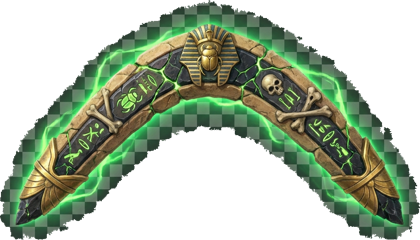 **A 바르한 베기** | 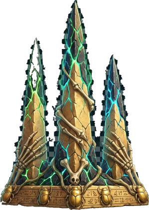 **B 모래 칼날** |
| --- | --- |
| 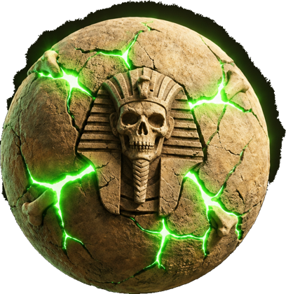 **C 모래폭풍** | 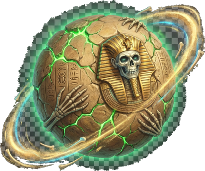 **D 압축 모래탄** |
| 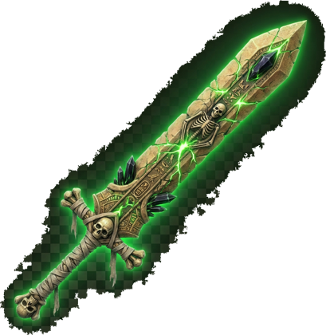 **E 대검 빔** |  |

- 탄막은 타일 소멸과 무관하게 플레이어에게만 작용, 파라오는 피해를 받지 않음

### 5-1-4. 승패 조건

- 클리어: 파라오 HP 0 이하
- 실패: 플레이어 HP 0

## 6. UI 및 조작

### 6-2. 상세 조작 및 스킬 규칙

- 이동: WASD 키 이용 (이동속도 3.0 타일/초, 대각선 0.707배).
- 텔레포트 (Space): 억까 패턴 대비용 기능. Space 키 입력 시 5타일 거리를 즉시 이동하며, 이동 시 전용 파티클 효과 발생 (쿨타임 5초, 하단 HUD 쿨타임 아이콘 표기).
- 공격 방향: 플레이어의 공격이 향하는 방향은 마우스 커서 방향을 기준으로 정조준됨.
- 공격 트리거 (마우스 좌클릭): 마우스 좌클릭 시 공격 발동 (애니메이션 진행 동안 짧은 시전 시간 동안 이동 정지).
- 오브 제거 (마우스 우클릭): 마우스 우클릭 입력 시 현재 소지 중인 속성 오브(Orb)를 해제/제거하는 형태로 수정.
- 시점: 탑뷰
- 이동: WASD
- 기믹 상호작용: 마우스

### 6-1. UI 컨셉 및 배치 정립

- 현재 장착/보유 중인 스태프(지팡이) 및 속성 오브(Orb)의 종류와 상태를 플레이어가 직관적으로 명확하게 확인할 수 있도록 UI 배치 정립 (Staff + Orb 결합 형태 아이콘 시각화).
- 텔레포트(5초 쿨타임) 기능에 대한 쿨타임 표기 아이콘(CD 쿨타임 게이지 및 타이머) 추가 정립.
- 플레이어 HP: 하트 UI로 표시
- 보스가 떨어뜨린 무기를 사용하는 기믹 존재
- 보스(건물) 위치: 화면 우측 끝에 배치, 가로로 고정하지 않고 세로 방향으로 이동

## 7. 인게임 화면 샘플

탑뷰 화면 기준으로 주요 요소의 배치와 역할을 정리했습니다. 샘플은 배치와 연출 방향 확인용이며, 수치와 실제 연출은 기획 확정 후 조정합니다.

| 화면 요소 | 위치 | 설명 |
| --- | --- | --- |
| 파라오 HP 바 | 상단 중앙 | 보스 이름과 파라오 HP 표시 |
| 경과 시간 | 우측 상단 | 클리어까지 진행 시간 표시 |
| 건물형 보스 | 우측 끝, 세로 이동 | 소환 주체, 직접 공격 대상 아님 |
| 플레이어 HP | 좌측 하단 | 하트 UI로 표시 |
| 이동 키 안내 | 우측 하단 | WASD 키 안내 |
| 변이 몹 | 전투 영역 | 미라, 아누비스, 호루스 등 소환 몹 |
| 드랍 아이템 | 몹 주변 | 보스 패턴 전개 직후 무작위 위치에 스태프 드랍(보스 패턴 이펙트/효과 사용), 소환된 미라가 5초마다 본인 고유 속성과 동일한 오브 드랍 |
| 기믹 연출 | 전체 화면 | 파라오 모래바람, 미라 사망 연출 및 파티클, 아누비스 강제 이동(아누비스 앞), 호루스 타일 소멸 모션 및 파티클 |
| 장착 스태프 & 오브 정보 | 하단 또는 캐릭터 주변 UI | 현재 획득 및 장착 중인 스태프 종류와 속성 오브(Orb)의 종류 정보를 명확하게 표시 |
| 텔레포트 쿨타임 아이콘 | 하단 HUD (스킬/이동 영역) | 5초 쿨타임을 가지는 텔레포트 스킬의 남은 쿨타임을 직관적으로 표기하는 전용 아이콘 및 게이지 배치 |

### 7-1. 인게임 예시 화면: 파라오

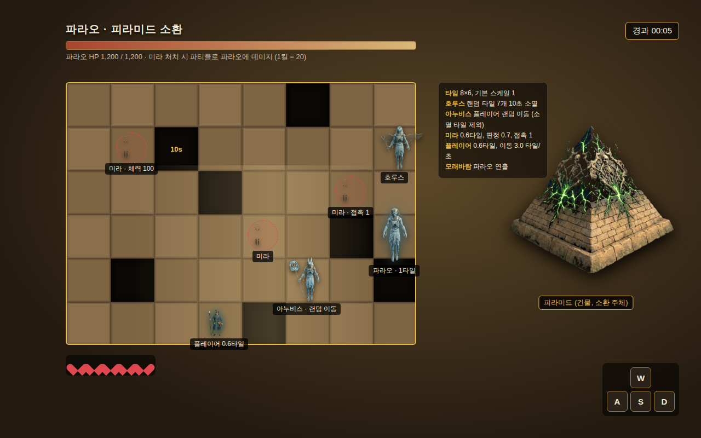

*파라오 · 16×12 타일, 호루스 타일 소멸, 아누비스 강제 이동, 미라 처치 시 파라오 데미지*

## 8. 디자인 샘플

|  Player | **Player** 탐험가 + 마법사 - 인디아나 존스 같은 탐험가의 모자 추가 - 로브를 추가해 마법사 요소 강화 |
| --- | --- |
| 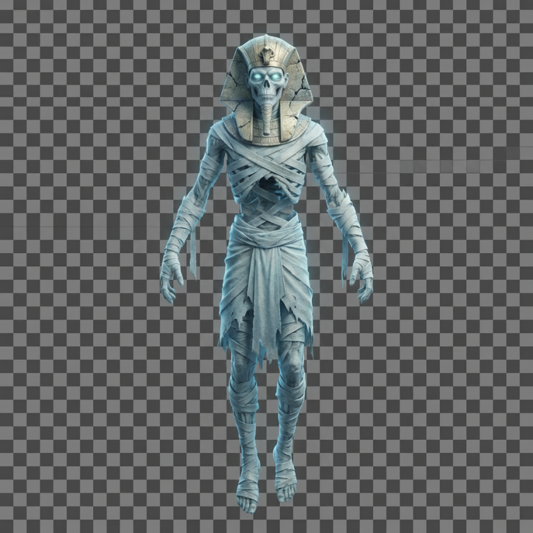 보스 (파라오) | **보스 (파라오)** 되살아난 파라오 - 되살아났다는 느낌을 주기 위한 유령 요소 추가 - 모래바람이 캐릭터 주위를 떠다니는 파티클 추가로 신비로움 강조 |
| 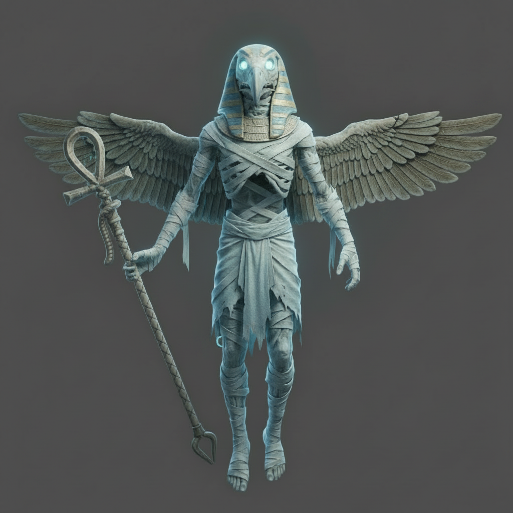 호루스 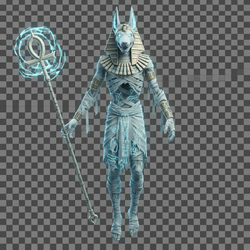 아누비스 | **네임드 몬스터 (아누비스 / 호루스)** 보스와 컨셉 통일 - 보스인 파라오와 컨셉을 통일 - 인수형 형태로 주술적 요소 추가 - 창백한 색감으로 언데드 요소 추가 |
| 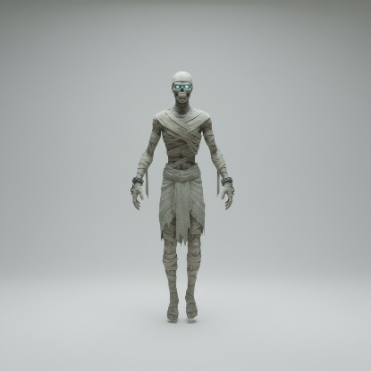 미라 (남성) 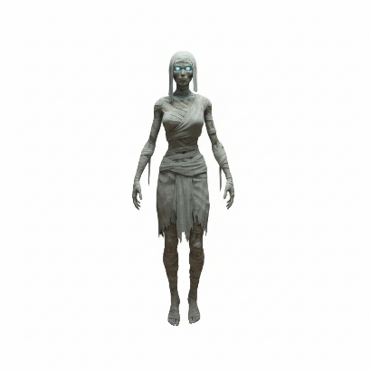 미라 (여성) | **몬스터 (미라 남성 / 여성)** - 보스와 컨셉 통일 (남성/여성 바리에이션) - 속성 가시성 부여: 4가지 속성(불: 붉은 화염/눈빛, 물: 푸른 아우라, 전기: 황색 스파크, 풀: 녹색 포자)에 맞춰 미라의 붕대/안광 색상 및 주위 파티클 이펙트를 다채롭게 연출하여 직관적 식별 가능 |

### 8-1. 캐릭터 스테이터스 요약

| 캐릭터 | 역할 | 크기 | 체력 | 이동 · 공격 | 드랍 · 연동 |
| --- | --- | --- | --- | --- | --- |
| 플레이어 | 탐험가 + 마법사 | 0.6 타일 | 하트 5칸, 무적 1초 | 이동 3.0 타일/초 (대각 0.707배) | 드랍 무기로 미라 처치 (공격 시전 시 짧은 정지 애니메이션, Staff + Orb 중앙 결합 형태 소지) |
| 파라오 | 소환 인물, 공격 주체 | 1타일 | HP 1,200 | 모래바람 · 소환 · 탄막 | 미라 1킬당 파티클 20 피해 (60킬) |
| 미라 | 근접, 접촉 피해 | 0.6 타일 (판정 0.7) | 체력 100, 접촉 피해 1 | 이동 1.5 타일/초, 파라오 앞에서 분당 6마리 리젠 | 처치 시 미라 속 오브가 파라오에게 직격하는 연출로 20 피해, 3초 주기(기존 7/5초→3초)로 속성 오브 드랍, 사망 모션 및 파티클 가시성 향상 |
| 호루스 | 타일 소멸, 방해 오브젝트 | 1타일 | 데미지 없음 | 이동 1.5 타일/초, 소멸 3초 전 붉은 워닝, 랜덤 타일 7개 10초 소멸 (소멸 타일 위 몹/플레이어 이동 불가, 사라지는 모션 & 파티클 연출) | 랜덤 타일 소멸 기믹 담당 (속성 아이템은 소환된 미라가 드랍) |
| 아누비스 | 강제 이동, 방해 오브젝트 | 1타일 | 데미지 없음 | 이동 1.5 타일/초, 25초마다 플레이어를 '아누비스 앞'으로 강제 이동 (사전 경고 표시 제거, 강제이동 중 무적 + 도착 후 0.5초 무적) | 25초마다 플레이어를 '아누비스 앞'으로 1초간 강제 이동시키는 방해 기믹 전담 (데미지 없음, 스태프 드랍과 분리) |

### 건물 (피라미드) 상태 변화

| 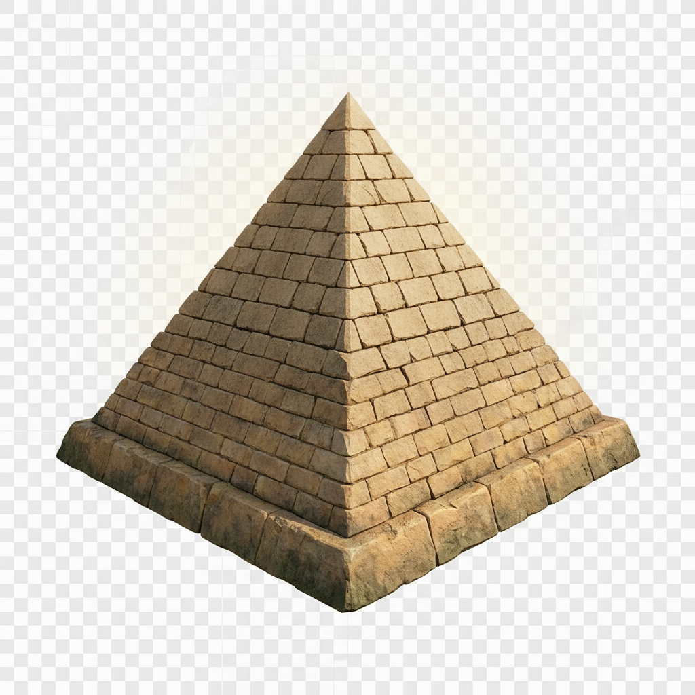 **디폴트 형태의 피라미드 (정화 후)** |  **언데드화 되어가는 피라미드 (진행 중)** |
| --- | --- |

### 8-2. 바닥 타일 디자인

|  **정화된 바닥 (기본)** |  **잠식된 바닥** |
| --- | --- |

## 9. 나중에 추가될 사항

- 카메라 무브
- UI (컨셉 및 HUD 배치: 스태프/오브 정보 표시, 텔레포트 5초 쿨타임 아이콘 포함 세부 정립 완료)
