# History Crash 기획안 v19

현대 판타지 배경의 감염된 건물/인물을 공략하는 게임

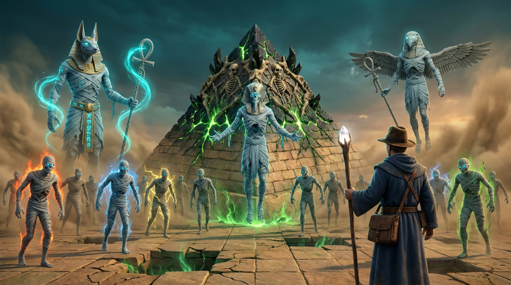

*메인 썸네일*

## 0. v19 변경 요약 (v18 → Unity 테스트 버전 반영)

Unity 테스트 버전(`History_Crash_Test_Obj_MCP_TEST`)을 만들면서 바뀐 조작·수치·패턴 형태를 반영했습니다. 아래 항목은 아직 구현 전이라 v18 내용을 그대로 유지합니다.

- 유지(미구현): 스태프·속성 오브 드랍과 획득, 플레이어 공격(스태프 + 오브), 아누비스 강제 이동, 미라 등 잡몹 배치, 모래바람 연출, 파라오 HP·정화 연출, UI
- 테스트용 설정(최종 확정 필요)으로 표기한 항목은 시뮬레이션 편의를 위한 값입니다.

| 구분 | v18 | v19 (Unity 테스트 버전) |
| --- | --- | --- |
| 시점 | 탑뷰 | 3인칭 추적 카메라(마우스 시점 회전, 휠 줌 2~12m, 장애물 충돌 시 당김) |
| 캐릭터 방향 | 명시 없음 | 항상 카메라가 보는 방향을 바라봄. 이동 방향별 애니메이션 블렌드(전진·후진·좌우·대각) |
| 전투 바닥 | 1×1 타일 16×12 | 신전 맵 바닥 38×30칸(칸 크기 0.975m), 기둥·벽·제단·석상 칸은 이동 불가 |
| 이동 속도 | 3.0 타일/초, 가속·감속 0.1초 | 4m/s(약 4.1칸/초), 가속·감속 없음 |
| 달리기 | 없음 | Shift 달리기 ×1.6 (6.4m/s) |
| Space | 텔레포트 5타일, 쿨타임 5초 | 점프(높이 1.1m, 체공 약 0.6초) |
| 점프 회피 | 없음 | 0.45m 이상 떠 있으면 B·E 패턴 회피, 소멸 타일을 점프로 건널 수 있음 |
| 플레이어 피격 판정 | 0.7 타일(공통) | 패턴별 판정 반경(A 0.45m, B 0.6m, C 폭발 1.1m, D 2.4m) |
| 보스 위치 | 화면 우측 끝, 세로 이동 | 맵 좌측 끝 제단 위 고정, 플레이어 방향으로 회전(초당 120°) |
| 패턴 선택 | 랜덤 사이클 2:3:1:2:2 | 테스트용: A→B→C→D→E 순차 반복, 패턴 사이 1.5초, 숫자키 1~5로 지정 |
| 패턴 형태·워닝 | 5-1-3 v18 표 | 5-1-3 v19 표 참조 |
| 호루스 | 이동하는 몬스터, 랜덤 7칸, 붉은 워닝 3초, 10초 소멸 | 호루스 석상이 기능 상속. 15초 주기, 바닥 무늬 1종 전체, 연두 워닝 2초, 7.5초 소멸 |
| 소멸 타일 | 이동 불가 | 구덩이: 서 있으면 낙하, 점프로 통과 가능 |
| 낙하 | 2 데미지, 초기 위치로 복귀 | 1 데미지, 마지막으로 서 있던 안전한 칸 근처로 복귀 + 1초 무적 |
| HP 0 | 실패 | 테스트용: 2초 뒤 HP 회복(실패 처리 미구현) |
| 플레이어 모델 | 탐험가 + 마법사 디자인 샘플 | 로브 마법사 모델 적용, 오른손 스태프 |

## 1. 레퍼런스

### 재미요소

- 패리맨 (오브젝트와 상호작용)

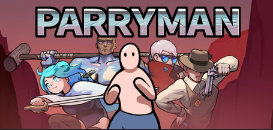

*재미요소 레퍼런스: 패리맨*

### 조작요소

- 엔터 더 건전: 고정된 보스의 탄막 액션
- 키보드/마우스를 이용한 조작

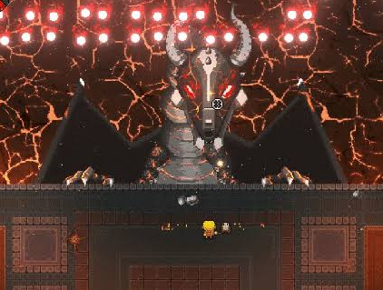

*조작요소 레퍼런스: 엔터 더 건전*

### 세계관

- 스타크래프트: 감염된 건물

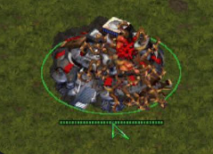

*세계관 레퍼런스: 스타크래프트*

## 2. 세계관

- 현대 판타지 배경
- 감염된 건물과 인물을 공략하는 구조

## 3. 핵심 재미

- 기믹형 보스(건물)의 패턴 공략
- 보스의 공격을 보스에게 되돌려 사용 (Use the boss's attack against it)
- (v19) 점프로 패턴(B·E)과 소멸 타일을 피하는 회피 플레이

## 4. 공략 방법

- 기믹을 파훼하며 진행
- 되살아난 문화적 인물을 변이시켜 몹으로 만듦
- 미라를 처치하면 파티클이 생기고, 파티클이 파라오에게 데미지를 줌

## 5. 보스 기믹 정리

### 5-1. 파라오 (이집트 테마) · 건물: 피라미드

- 모래바람으로 화면을 가림 (미구현)
  - 모래를 이용한 패턴 공격
  - 참고 링크: <https://blog.naver.com/yuhojun123/40177001788>
- 몬스터 소환: 미라, 아누비스, 호루스
  - 미라: 파라오 앞에서 리젠, 체력 100, 접촉 시 플레이어에게 1 데미지, 처치 시 파라오에게 파티클 데미지 (미구현)
  - 아누비스·호루스: 데미지 없이 방해 오브젝트로 작용
    - (v19) 아누비스·호루스의 기능은 신전의 석상이 상속하여 고정 오브젝트로 작동
    - 아누비스(석상): 25초마다 플레이어를 '아누비스 앞'으로 강제 이동시키는 방해 기믹 전담 (이동위치 사전 경고 표시 제거로 기습성 향상, 강제 이동 진행 중 무적 판정 및 이동 완료 직후 0.5초 무적 추가 부여). (미구현)
    - 호루스(석상, v19): 15초 주기로 석상의 눈이 빛나며, 바닥 타일 무늬 12종 중 한 종류의 칸 전체가 2초간 연두색으로 발광(바닥 균열 발광색과 통일)한 뒤 부서져 7.5초간 사라졌다가 수복됨 (첫 발동 5초)
    - 소멸 타일은 어두운 구덩이(심연)로 표시되며, 그 위에 서 있으면 낙하 연출 후 1 데미지, 마지막으로 서 있던 안전한 칸 근처로 복귀하며 1초 무적 적용
    - 소멸 타일은 점프로 건널 수 있음 (v18의 '이동 불가'에서 변경)
- 보스 패턴 전개 직후 무작위 위치에 스태프(지팡이)가 드랍되어, 플레이어가 이를 재활용 시 보스의 해당 공격 패턴과 동일/유사한 이펙트 및 판정 효과가 발동함 (속성 조합 시 해당 속성에 맞는 전용 파티클 이펙트 추가 부여 / A: 부메랑 탄막, B: 스파이크 근접, C: 오브 확산, D: 메테오 범위, E: 검 스나이핑) (미구현)
  - 보스 패턴 시전 및 스태프 드랍 규칙: 보스가 5개 패턴 중 1개를 랜덤 사이클로 선택하여 시전하며, 이때 각 패턴의 시전 비율은 2:3:1:2:2 (A 부메랑 탄막: 2 · B 스파이크 근접: 3 · C 오브 확산: 1 · D 메테오 범위: 2 · E 검 스나이핑: 2)로 적용됨. 보스가 패턴을 시전하면 해당 시전 패턴에 대응하는 스태프가 필드 무작위 위치에 드랍되어 플레이어가 보스 공격을 재활용할 수 있음.
  - (v19 테스트용) 현재 테스트 버전은 A→B→C→D→E 순차 반복(패턴 사이 1.5초)이며, 랜덤 비율 적용은 최종 확정 필요

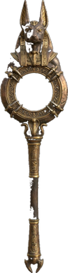

*아누비스 드랍템(지팡이) 참고 이미지*

- 소환된 미라 (속성 아이템 드랍): 리젠 시 4가지 속성(불 25% · 물 25% · 전기 25% · 풀 25%)이 동률로 무작위 부여되며, 붕대/눈빛 테마 색상과 전용 파티클 효과로 가시성을 향상함. 미라가 3초 주기로 본인의 고유 속성과 동일한 오브(속성 아이템)를 드랍. (미구현)

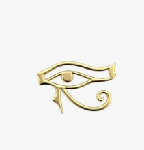

*미라 드랍템(속성 아이템) 참고 이미지*

### 5-1-0. 신규 연출, 비주얼 및 장비 시스템 개편 사항

- 스태프 & 오브 장착 메커니즘 개편: 드랍 오브젝트 모델링 변경 적용. 플레이어가 획득한 오브(속성 아이템)에 따라 소지하는 형태로 변경되며, Staff + Orb 결합 방식으로 Staff 중앙부의 빈 공간에 Orb가 결합/삽입되는 형태 연출. (스태프의 디스폰 시간은 전면 제거되어 획득 전까지 필드에 영구 유지됨). (미구현)
- (v19) 획득 모션: 스태프와 오브를 떨어뜨린 맨손 상태에서 회수. 바닥에 꽂힌 스태프는 오른손으로 서서 집고, 바닥의 오브는 몸을 숙여 왼손으로 집음 (정지 상태 전용, 이동 중 사용 X)
- 시전 애니메이션 및 조작 규칙: 플레이어 공격 시전 시 전용 애니메이션 추가 (애니메이션 진행 동안 짧은 시전 시간 동안 이동 정지). 파라오 보스는 패턴 전개 시 고유 전용 애니메이션 동작 수행. (파라오 패턴별 시전 애니메이션 적용 완료, 플레이어 공격은 미구현)
- (v19) 플레이어 이동 애니메이션: 대기, 전진·후진 달리기, 좌우 옆 스텝, 대각 블렌드, 점프 공중 동작. 재생 속도는 이동 속도와 방향별 보폭에 맞춰 조절
- (v19) 바닥 예고 표시: B는 바닥 균열(연두), D는 문양(파랑 계열)으로 표시. 호루스 경고는 붉은색 대신 바닥 균열과 같은 연두 발광
- 미라 사망 연출 강화: 미라 사망 시 전용 모션/애니메이션 추가. 미라 처치 시 미라 내부의 속성 오브가 튀어나와 파라오에게 직격하는 피격 연출로 시각적 쾌감 강화. (미구현)
- 아누비스 강제 이동 기믹 개선: 아누비스의 이동 위치 확인(사전 워닝 장판 표시)을 제거하여 플레이의 긴장감 부여. 강제 이동 기믹 진행 중에는 무적 상태 유지 및 이동 완료 후 0.5초간 추가 무적 부여. (미구현)
- 배경 및 밸런스: 신전 맵(기둥·벽·제단·석상 배치)으로 전투 공간 구성

### 5-1-1. 파훼 시 정화

- 보스(파라오)를 파훼하면 정화 연출로 전환
- 언데드화된 피라미드가 디폴트 형태로 복원
- 소환 몹(미라, 아누비스, 호루스) 소멸, 모래바람 해제

### 5-1-2. 스테이터스 (파라오 기준)

| 항목 | 값 | 비고 |
| --- | --- | --- |
| 파라오 총 HP | 1,200 | 플레이어는 직접 공격하지 않음 (미구현) |
| 미라 1킬 파티클 피해 | 20 | 파라오에게 전달 |
| 필요 킬 수 | 60 | 1200 ÷ 20 |
| 미라 체력 | 100 | 1킬 무기 ≥100 피해, 2킬 무기 1발 50 |
| 미라 접촉 피해 | 1 | 플레이어에게 부딪힐 때 |
| 파라오 크기 | 1타일 | 호루스·아누비스와 동일 |
| 파라오 위치 (v19) | 맵 좌측 끝 제단 위 고정 | 이동 없이 플레이어 방향으로 회전(초당 120°) |
| 소환 몹 이동속도 | 1.5 타일/초 | 플레이어 이동속도 변경에 맞춰 재조정 필요 |
| 호루스·아누비스 (v19) | 데미지 없음, 석상이 기능 상속 | 고정 오브젝트. 아누비스는 미구현 |
| 소멸 타일 낙하 피해 (v19) | 1 | 낙하 연출 후 마지막 안전 칸 근처로 복귀 + 1초 무적 |
| 목표 플레이 타임 | 스피드런 10분 / 일반 15분 | 스피드런은 최적화 플레이, 일반은 여유 있는 플레이 |
| 미라 리젠 | 분당 6마리, 파라오 앞 | 10분 기준 총 60마리 등장 |
| 공격 방식 | 지팡이 + 속성 아이템 | 스태프 + 속성 아이템 조합 1회 = 공격 1회 (미구현) |
| 플레이어 HP | 하트 5칸 | 피격 후 무적 1초. (v19 테스트용) HP 0이면 2초 뒤 회복 |
| 플레이어 피격 판정 (v19) | 패턴별 반경 | A 투사체 0.45m · B 함정 0.6m · C 폭발 1.1m · D 태양 2.4m |
| 속성 아이템 드랍률 | 각 25% | 불·물·전기·풀 동률 |
| 보스 패턴 시전 비율 & 스태프 드랍 | 2:3:1:2:2 (랜덤 사이클) | (v19 테스트용) A→E 순차, 패턴 사이 1.5초, 전개 속도 배율 1.3 |
| 속성 아이템 드랍 방식 | 3초 주기로 미라 드랍 | 미구현 |
| 드랍물 유지 시간 | 스태프: 무제한 / 속성 오브: 12초 | 미구현 |
| 전투 바닥 (v19) | 0.975m 칸 38×30 | 신전 맵 바닥, 장애물 칸 이동 불가 |
| 플레이어 이동속도 (v19) | 4m/s (약 4.1칸/초) | 가속·감속 없음, 대각 정규화, Shift 달리기 ×1.6 |
| 플레이어 점프 (v19) | 높이 1.1m, 체공 약 0.6초 | 0.45m 이상에서 B·E 회피 |
| 플레이어 크기 (v19) | 충돌 반경 0.25m | 모델 키 약 1.07m |
| 미라 크기 | 0.6 타일 | 플레이어 크기 변경에 맞춰 재조정 필요 |
| 미라 판정 범위 | 약 0.7타일 | 시각 크기보다 약간 크게, 형태는 동일 |
| 호루스·아누비스 크기 | 석상 | 신전 맵 석상 사용 |

### 5-1-3. 파라오 탄막 (참고: 크로커다일 사막 기술)

- 파라오가 5개 패턴을 시전 (v19 테스트용: A→B→C→D→E 순차, 패턴 사이 1.5초)
- 패턴 전개 속도 배율 1.3 (시전 애니메이션, 예고·대기 시간, 투사체 속도에 공통 적용). 아래 시간은 배율 반영값

| 패턴 | 참고 기술 | 전개 방식 (v19) | 워닝 (v19) | 피해 |
| --- | --- | --- | --- | --- |
| A 바르한 베기 (코페쉬 투척) | 초승달 사구 / 부메랑 | 던지기 직전(약 2.1초)까지 플레이어를 조준하다 방향을 고정하고 직선으로 빠르게 투척(20m/s). 플레이어 위치를 지나 최대 12m 날아가 바닥에서 깨짐 | 별도 바닥 표시 없음 (조준 동작이 예고) | 1 |
| B 모래 칼날 (함정) | 사막의 보검 / 스파이크 | 플레이어 주변 4칸 안에 함정 3개가 서로 겹치지 않게 솟음(60% 확률로 1칸 이내 노림). 함정 하나 약 2×2.5m. 점프로 회피 가능 | 바닥 균열 0.7초 | 1 |
| C 모래폭풍 (보석 5연발) | 모래폭풍 / 확산 | 보석 5개를 순서대로 발사하며, 각 보석은 발사 순간의 플레이어 위치로 조준(28m/s). 착탄 폭발 반경 1.1m. 피격 후 무적을 무시하고 맞을 때마다 피해 | 조준 동작(약 1.7~3.4초 구간) | 1 |
| D 메테오 (태양 낙하) | 모래바람의 보검 / 메테오 | 플레이어 1칸 안에 태양이 떨어져 깨짐. 태양 반지름 약 2.9m(지름 5~6칸), 판정 반경 2.4m. 깨진 파편은 바닥에 남았다가 사라짐 | 바닥 문양 약 2.9초 | 1 |
| E 대검 빔 (지팡이 줄 발사) | 사막의 대검 / 검 | 플레이어가 선 줄 기준 ±2·±4줄에서 지팡이가 격자 +X 방향으로 직선 발사. 6m 이후 벽·기둥에 닿으면 깨짐. 대각 없음. 점프로 회피 가능 | 줄 정렬·조준 동작 | 1 |

### 패턴별 오브젝트 이미지

| 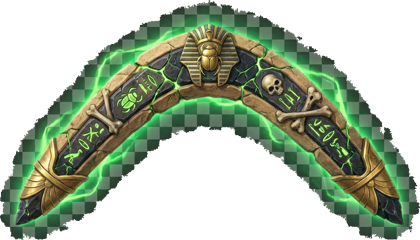 **A 바르한 베기** | 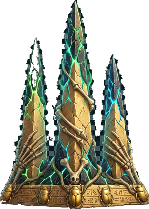 **B 모래 칼날** |
| --- | --- |
| 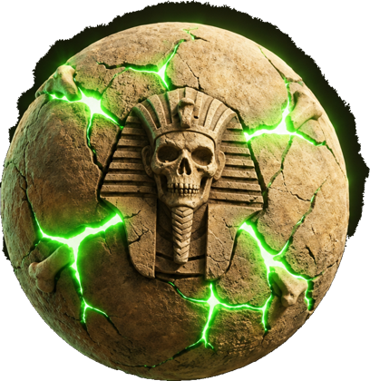 **C 모래폭풍** | 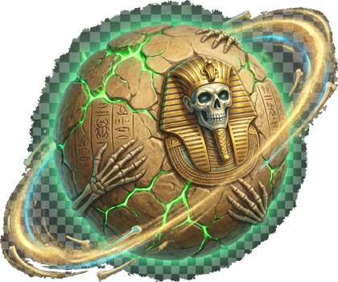 **D 압축 모래탄** |
| 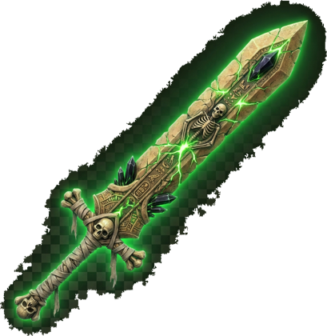 **E 대검 빔** |  |

- 탄막은 타일 소멸과 무관하게 플레이어에게만 작용, 파라오는 피해를 받지 않음
- (v19) B·E는 점프로 0.45m 이상 떠 있으면 피할 수 있음

### 5-1-4. 승패 조건

- 클리어: 파라오 HP 0 이하 (미구현)
- 실패: 플레이어 HP 0 (v19 테스트용: 2초 뒤 회복, 실패 처리 미구현)

## 6. UI 및 조작

### 6-2. 상세 조작 및 스킬 규칙 (v19)

- 이동: WASD 키, 카메라가 보는 방향 기준으로 전후좌우 이동 (4m/s, 대각 정규화, 가속·감속 없음)
- 달리기 (Shift): 이동 속도 ×1.6
- 점프 (Space): 높이 1.1m. 소멸 타일을 건너거나 B·E 패턴 회피에 사용. (v18의 텔레포트 5타일·쿨타임 5초를 대체)
- 시점: 마우스로 카메라 회전, 휠로 거리 조절(2~12m). 캐릭터는 항상 카메라가 보는 방향을 바라봄
- 공격 방향: 플레이어의 공격이 향하는 방향은 마우스 커서 방향을 기준으로 정조준됨. (미구현, 3인칭 시점에 맞춰 조준 방식 재검토 필요)
- 공격 트리거 (마우스 좌클릭): 마우스 좌클릭 시 공격 발동 (애니메이션 진행 동안 짧은 시전 시간 동안 이동 정지). (미구현)
- 오브 제거 (마우스 우클릭): 현재 소지 중인 속성 오브(Orb)를 해제/제거. (미구현)
- 테스트용 키: 숫자 1~5로 다음 패턴 지정, P로 자동 진행 켜기·끄기

### 6-1. UI 컨셉 및 배치 정립

- 현재 장착/보유 중인 스태프(지팡이) 및 속성 오브(Orb)의 종류와 상태를 플레이어가 직관적으로 명확하게 확인할 수 있도록 UI 배치 정립 (Staff + Orb 결합 형태 아이콘 시각화).
- (v19) 텔레포트 쿨타임 아이콘은 점프로 대체되어 재검토 필요
- 플레이어 HP: 하트 UI로 표시
- 보스가 떨어뜨린 무기를 사용하는 기믹 존재
- (v19) 보스(파라오) 위치: 맵 좌측 끝 제단 위 고정

## 7. 인게임 화면 샘플

3인칭 시점 기준으로 주요 요소의 배치와 역할을 정리했습니다. 샘플은 배치와 연출 방향 확인용이며, 수치와 실제 연출은 기획 확정 후 조정합니다.

| 화면 요소 | 위치 | 설명 |
| --- | --- | --- |
| 파라오 HP 바 | 상단 중앙 | 보스 이름과 파라오 HP 표시 |
| 경과 시간 | 우측 상단 | 클리어까지 진행 시간 표시 |
| 건물형 보스 (v19) | 맵 좌측 끝 제단 위 고정 | 소환 주체, 직접 공격 대상 아님. 플레이어 방향으로 회전 |
| 플레이어 HP | 좌측 하단 | 하트 UI로 표시 |
| 조작 안내 (v19) | 우측 하단 | WASD 이동 · Shift 달리기 · Space 점프 · 마우스 시점 |
| 변이 몹 | 전투 영역 | 미라 (아누비스·호루스는 석상) |
| 드랍 아이템 | 몹 주변 | 보스 패턴 전개 직후 무작위 위치에 스태프 드랍, 소환된 미라가 3초마다 고유 속성 오브 드랍 |
| 기믹 연출 | 전체 화면 | 파라오 모래바람, 미라 사망 연출 및 파티클, 아누비스 강제 이동, 호루스 석상 눈 발광 + 타일 붕괴·심연·파티클 |
| 장착 스태프 & 오브 정보 | 하단 또는 캐릭터 주변 UI | 현재 획득 및 장착 중인 스태프 종류와 속성 오브(Orb)의 종류 정보를 명확하게 표시 |
| 점프/이동 안내 (v19) | 하단 HUD | 텔레포트 쿨타임 아이콘 대체 여부 재검토 |

### 7-1. 인게임 예시 화면: 파라오

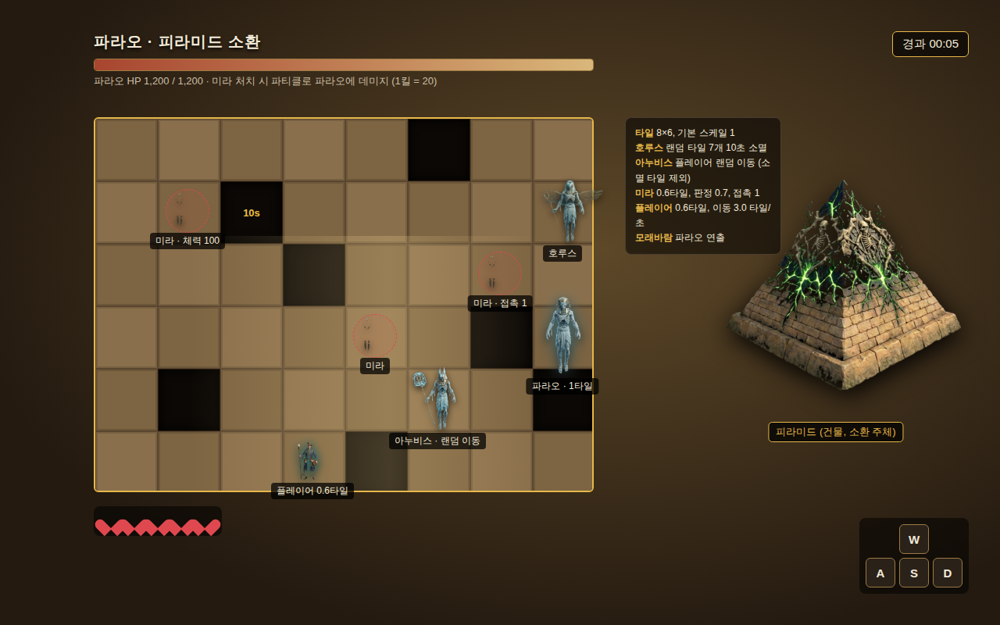

*v18 예시 화면(16×12 탑뷰). v19 테스트 버전은 38×30 신전 맵, 3인칭 시점*

## 8. 디자인 샘플

| 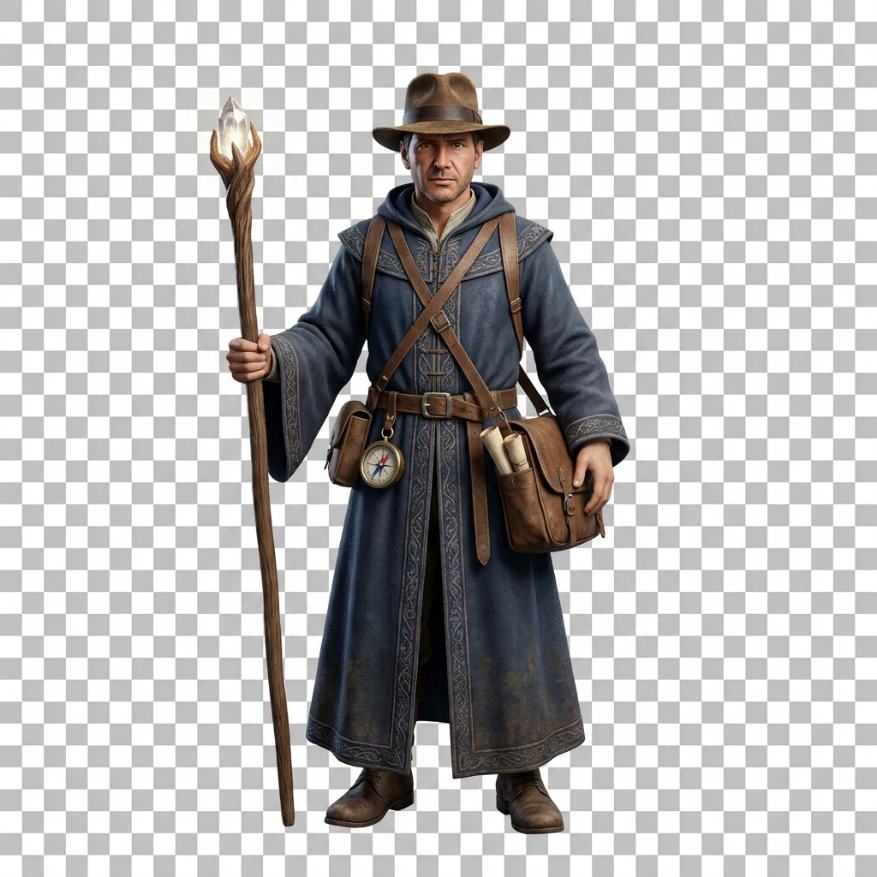 Player | **Player** 탐험가 + 마법사 - 인디아나 존스 같은 탐험가의 모자 추가 - 로브를 추가해 마법사 요소 강화 - (v19) 로브 마법사 모델 적용, 오른손 스태프. 로브 자락은 Blender Cloth로 제작(Unity는 현재 뼈대만 따라 움직임) |
| --- | --- |
| 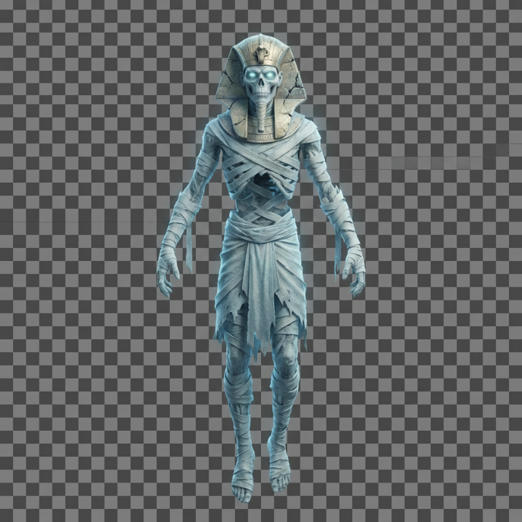 보스 (파라오) | **보스 (파라오)** 되살아난 파라오 - 되살아났다는 느낌을 주기 위한 유령 요소 추가 - 모래바람이 캐릭터 주위를 떠다니는 파티클 추가로 신비로움 강조 |
| 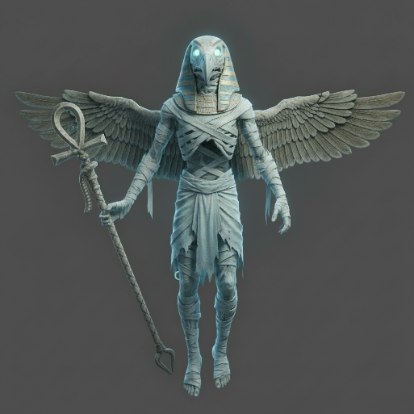 호루스 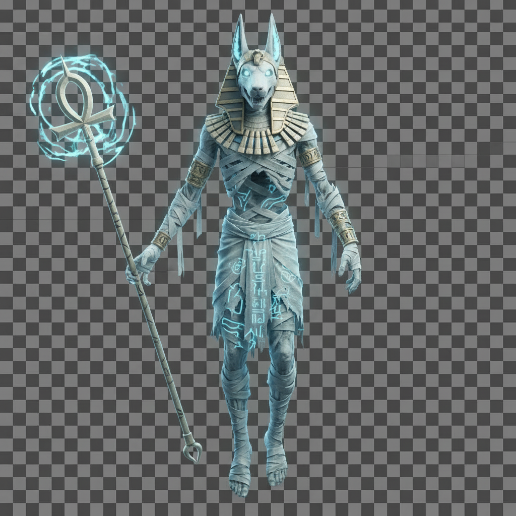 아누비스 | **네임드 몬스터 (아누비스 / 호루스)** 보스와 컨셉 통일 - 보스인 파라오와 컨셉을 통일 - 인수형 형태로 주술적 요소 추가 - 창백한 색감으로 언데드 요소 추가 - (v19) 신전 석상이 기능을 상속 |
| 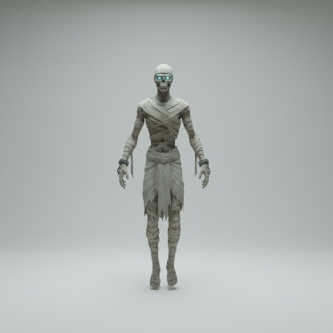 미라 (남성) 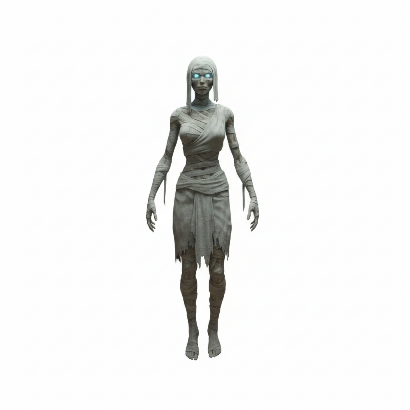 미라 (여성) | **몬스터 (미라 남성 / 여성)** - 보스와 컨셉 통일 (남성/여성 바리에이션) - 속성 가시성 부여: 4가지 속성(불: 붉은 화염/눈빛, 물: 푸른 아우라, 전기: 황색 스파크, 풀: 녹색 포자)에 맞춰 미라의 붕대/안광 색상 및 주위 파티클 이펙트를 다채롭게 연출하여 직관적 식별 가능 |

### 8-1. 캐릭터 스테이터스 요약

| 캐릭터 | 역할 | 크기 | 체력 | 이동 · 공격 | 드랍 · 연동 |
| --- | --- | --- | --- | --- | --- |
| 플레이어 (v19) | 탐험가 + 마법사 | 충돌 반경 0.25m, 키 약 1.07m | 하트 5칸, 무적 1초 | 이동 4m/s, Shift ×1.6, 점프 1.1m | 드랍 무기로 미라 처치 (미구현), 맨손 획득 모션(스태프 오른손·오브 왼손) |
| 파라오 (v19) | 소환 인물, 공격 주체 | 1타일 | HP 1,200 (미구현) | 좌측 제단 고정·회전, 패턴 A~E | 미라 1킬당 파티클 20 피해 (60킬) |
| 미라 | 근접, 접촉 피해 | 0.6 타일 (판정 0.7) | 체력 100, 접촉 피해 1 | 이동 1.5 타일/초 (재조정 필요), 파라오 앞에서 분당 6마리 리젠 | 처치 시 오브가 파라오에게 직격하는 연출로 20 피해, 3초 주기 속성 오브 드랍 (미구현) |
| 호루스 (v19 석상) | 타일 붕괴, 방해 오브젝트 | 석상 | 데미지 없음 | 고정. 15초 주기, 연두 워닝 2초, 타일 무늬 1종 7.5초 붕괴 | 소멸 칸은 구덩이(점프로 통과 가능, 낙하 1 데미지) |
| 아누비스 (v19 석상) | 강제 이동, 방해 오브젝트 | 석상 | 데미지 없음 | 25초마다 플레이어를 '아누비스 앞'으로 강제 이동 (미구현) | 데미지 없음, 스태프 드랍과 분리 |

### 건물 (피라미드) 상태 변화

| 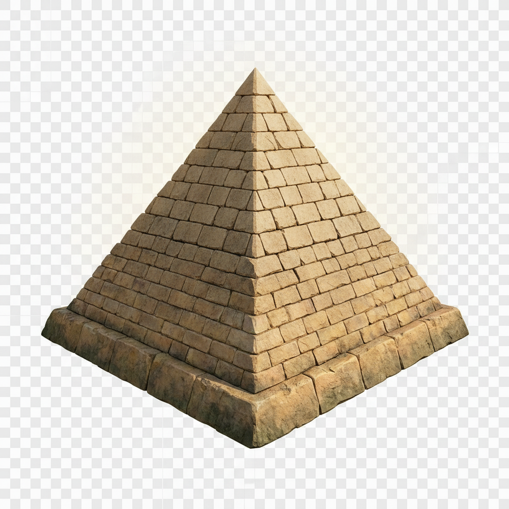 **디폴트 형태의 피라미드 (정화 후)** | 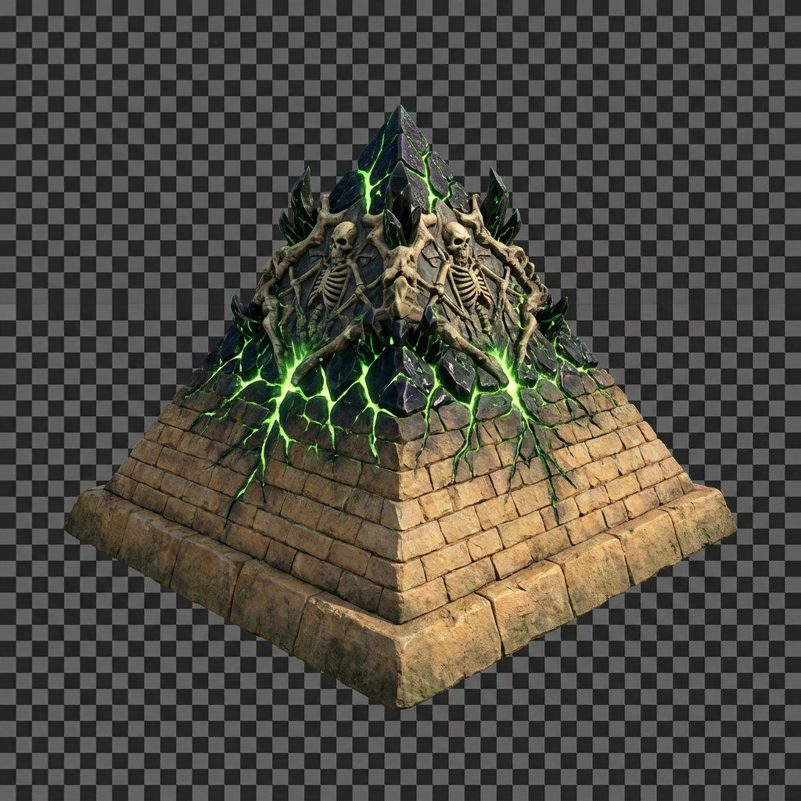 **언데드화 되어가는 피라미드 (진행 중)** |
| --- | --- |

### 8-2. 바닥 타일 디자인

| 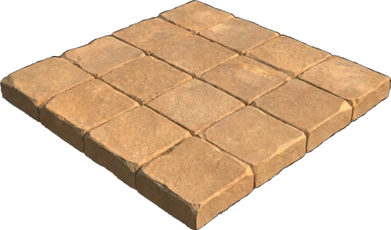 **정화된 바닥 (기본)** | 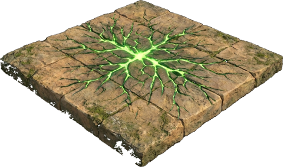 **잠식된 바닥** |
| --- | --- |

- (v19) 바닥 무늬 12종(Tile_Crack_A~L), 균열 연두 발광. 호루스 붕괴는 무늬 종류 단위로 발생

## 9. 나중에 추가될 사항

- 카메라 무브 (v19: 3인칭 추적 카메라 기본 적용, 연출용 카메라 무브는 추가 예정)
- UI (컨셉 및 HUD 배치: 스태프/오브 정보 표시, 점프 대체에 따른 HUD 재정립)
- 스태프·오브 드랍과 획득, 플레이어 공격, 아누비스 강제 이동, 미라 배치, 모래바람 연출
- 패턴 선택 방식 확정 (랜덤 2:3:1:2:2 적용 여부), 플레이어 속도 변경에 따른 몹 이동속도·크기 재조정
- 로브 Cloth의 Unity 적용, 옆 이동 속도와 옆 스텝 애니메이션 보폭 맞춤
