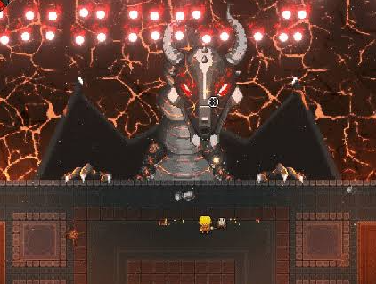
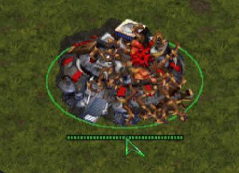
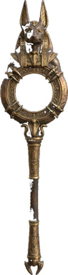
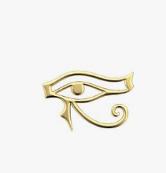
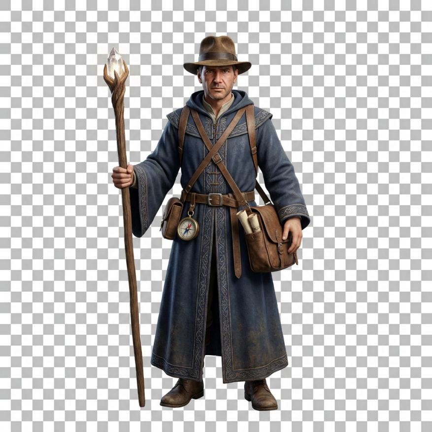
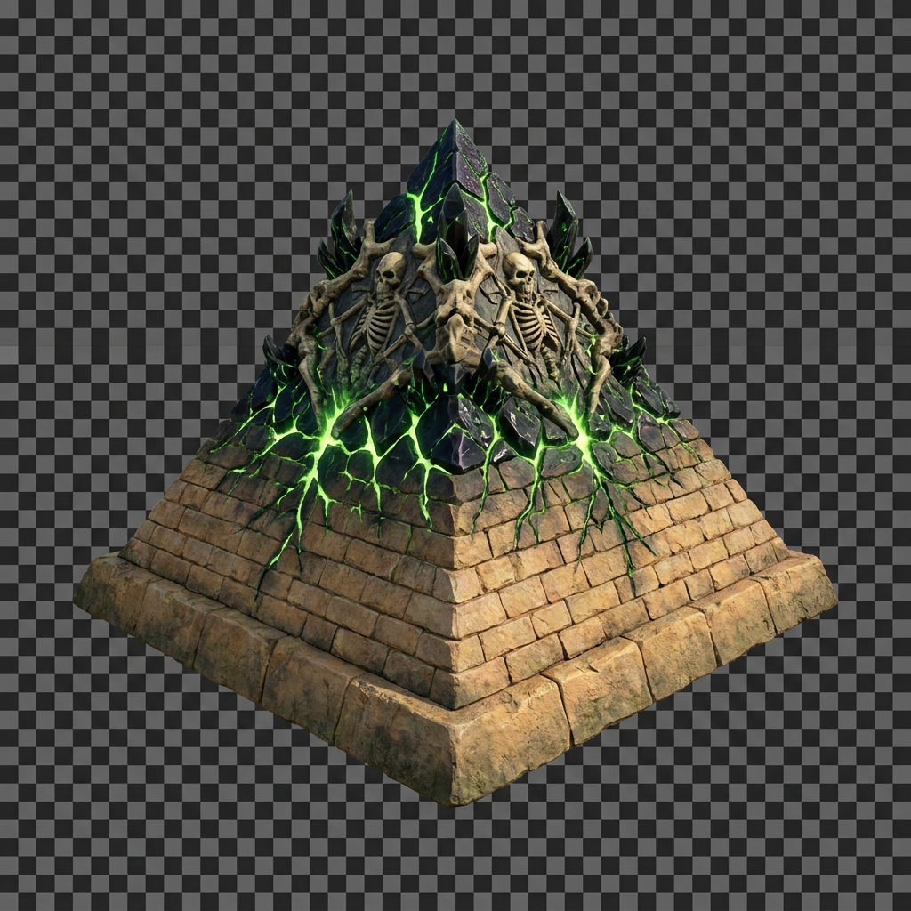
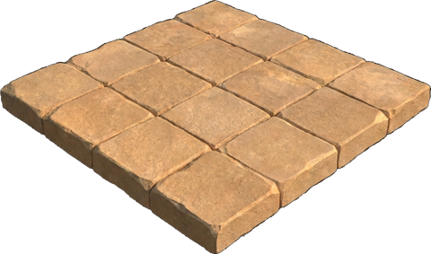
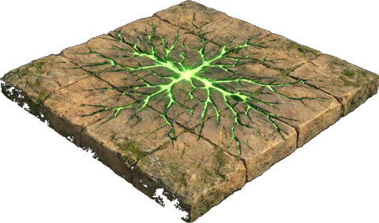

# History Crash 기획안

현대 판타지 배경의 감염된 건물/인물을 공략하는 게임

## 1. 레퍼런스

### 재미요소

- 패리맨 (오브젝트와 상호작용)

재미요소 레퍼런스: 패리맨

### 조작요소

- 엔터 더 건전: 고정된 보스의 탄막 액션

- 키보드/마우스를 이용한 조작

### 세계관

- 스타크래프트: 감염된 건물

## 2. 세계관

- 현대 판타지 배경

- 감염된 건물과 인물을 공략하는 구조

## 3. 핵심 재미

- 기믹형 보스(건물)의 패턴 공략

- 보스의 공격을 보스에게 되돌려 사용 (Use the boss's attack against it)

## 4. 공략 방법

- 기믹을 파훼하며 진행

- 되살아난 문화적 인물을 변이시켜 몹으로 만듦

- 미라를 처치하면 파티클이 생기고, 파티클이 파라오에게 데미지를 줌

## 5. 보스 기믹 정리

### 5-1. 파라오 (이집트 테마) · 건물: 피라미드

- 모래바람으로 화면을 가림

  - 모래를 이용한 패턴 공격

  - 참고 링크: https://blog.naver.com/yuhojun123/40177001788

- 몬스터 소환: 미라, 아누비스, 호루스

  - 미라: 체력 100, 접촉 시 플레이어에게 데미지(히트박스), 처치 시
    파라오에게 파티클 데미지

  - 아누비스·호루스: 데미지 없이 방해 오브젝트로 작용, 시간이 지나면
    드랍

    - 아누비스: 25초마다 플레이어를 지정 지점으로 1초간 강제 이동

    - 호루스: 랜덤 타일 7개를 소멸 3초 전 붉은 워닝 표시 후 10초 동안
      소멸

    - 소멸 타일 위의 플레이어는 2 데미지, 몹은 밖으로 밀려남

- 무덤 구덩이 (CC기)

- 소환 몬스터의 드랍품으로 공격

  - 아누비스 (지팡이, 드랍 비율 3:2:2:2:1): 근접 3(2킬) · 발사 2(2킬) ·
    스나이핑 2(1킬) · 범위 2(2킬) · 확산 1(1킬)

- 호루스 (속성 아이템, 드랍률 동률): 불 25% · 물 25% · 전기 25% · 풀 25%

#### 5-1-1. 파훼 시 정화

- 보스(파라오)를 파훼하면 정화 연출로 전환

- 언데드화된 피라미드가 디폴트 형태로 복원

- 소환 몹(미라, 아누비스, 호루스) 소멸, 모래바람 해제

#### 5-1-2. 스테이터스 (파라오 기준, 최단 클리어 약 10분)

| **항목**              | **값**       | **비고**                               |
|-----------------------|--------------|----------------------------------------|
| 파라오 총 HP          | 1,200        | 플레이어는 직접 공격하지 않음          |
| 미라 1킬 파티클 피해  | 20           | 파라오에게 전달                        |
| 필요 킬 수            | 60           | 1200 ÷ 20                              |
| 미라 체력             | 100          | 1킬 무기 ≥100 피해, 2킬 무기 1발 50    |
| 미라 접촉 피해        | 1            | 플레이어에게 부딪힐 때                 |
| 파라오 크기           | 1타일        | 호루스·아누비스와 동일                 |
| 소환 몹 이동속도      | 1.5 타일/초  | 플레이어의 절반 (미라·호루스·아누비스) |
| 호루스·아누비스       | 데미지 없음  | 방해 오브젝트로 작용                   |
| 소멸 타일 피해        | 2            | 소멸 타일 위의 플레이어에게            |
| 미라 리젠             | 분당 6마리   | 10분간 총 60마리 등장                  |
| 플레이어 HP           | 하트 5칸     | 피격 후 무적 1초, 깜빡임 표시          |
| 플레이어 피격 판정    | 0.7 타일     | 시각 크기 0.6보다 약간 크게            |
| 지팡이 드랍 비율      | 3:2:2:2:1    | 근접·발사·스나이핑·범위·확산 순        |
| 속성 아이템 드랍률    | 각 25%       | 불·물·전기·풀 동률                     |
| 지팡이 드랍 주기      | 약 7초       | 1회성, 1회 공격 후 소멸                |
| 속성 아이템 드랍 주기 | 약 7초       | 1회성, 드랍률 동률 유지                |
| 드랍물 유지 시간      | 12초         | 미획득 시 사라짐                       |
| 전투 바닥             | 1×1 타일 8×6 | 플랫 타일, 기본 스케일 1               |
| 플레이어 이동속도     | 3.0 타일/초  | 대각선은 0.707배, 가속·감속 0.1초      |
| 플레이어 크기         | 0.6 타일     | 탑뷰 기준                              |
| 미라 크기             | 0.6 타일     | 플레이어와 동일 비율                   |
| 미라 판정 범위        | 약 0.7타일   | 시각 크기보다 약간 크게, 형태는 동일   |
| 호루스·아누비스 크기  | 타일 1칸     | 타일과 동일 스케일                     |

#### 5-1-3. 승패 조건

- 클리어: 파라오 HP 0 이하

- 실패: 플레이어 HP 0

## 6. UI 및 조작

- 시점: 탑뷰

- 이동: WASD

- 기믹 상호작용: 마우스

- 플레이어 HP: 하트 UI로 표시

- 보스가 떨어뜨린 무기를 사용하는 기믹 존재

- 보스(건물) 위치: 화면 우측 끝에 배치, 가로로 고정하지 않고 세로
  방향으로 이동

## 7. 인게임 화면 샘플

탑뷰 화면 기준으로 주요 요소의 배치와 역할을 정리했습니다. 샘플은 배치와
연출 방향 확인용이며, 수치와 실제 연출은 기획 확정 후 조정합니다.

| **화면 요소** | **위치**           | **설명**                                                                    |
|---------------|--------------------|-----------------------------------------------------------------------------|
| 파라오 HP 바  | 상단 중앙          | 보스 이름과 파라오 HP 표시                                                  |
| 경과 시간     | 우측 상단          | 클리어까지 진행 시간 표시                                                   |
| 건물형 보스   | 우측 끝, 세로 이동 | 소환 주체, 직접 공격 대상 아님                                              |
| 플레이어 HP   | 좌측 하단          | 하트 UI로 표시                                                              |
| 이동 키 안내  | 우측 하단          | WASD 키 안내                                                                |
| 변이 몹       | 전투 영역          | 미라, 아누비스, 호루스 등 소환 몹                                           |
| 드랍 아이템   | 몹 주변            | 아누비스·호루스 드랍                                                        |
| 기믹 연출     | 전체 화면          | 파라오 모래바람, 미라 처치, 아누비스 강제 이동(25초 주기), 호루스 타일 소멸 |

### 7-1. 인게임 예시 화면: 파라오

파라오 · 8×6 타일, 호루스 타일 소멸, 아누비스 강제 이동, 미라 처치 시
파라오 데미지

## 8. 디자인 샘플

<table>
<colgroup>
<col style="width: 37%" />
<col style="width: 62%" />
</colgroup>
<tbody>
<tr class="odd">
<td>

Player
</td>
<td>
<strong>Player</strong>

탐험가 + 마법사

<ul>
<li>
인디아나 존스 같은 탐험가의 모자 추가
</li>
<li>
로브를 추가해 마법사 요소 강화
</li>
</ul></td>
</tr>
<tr class="even">
<td>

보스 (파라오)
</td>
<td>
<strong>보스 (파라오)</strong>

되살아난 파라오

<ul>
<li>
되살아났다는 느낌을 주기 위한 유령 요소 추가
</li>
<li>
모래바람이 캐릭터 주위를 떠다니는 파티클 추가로 신비로움
강조
</li>
</ul></td>
</tr>
<tr class="odd">
<td>

호루스

아누비스
</td>
<td>
<strong>네임드 몬스터 (아누비스 / 호루스)</strong>

보스와 컨셉 통일

<ul>
<li>
보스인 파라오와 컨셉을 통일
</li>
<li>
인수형 형태로 주술적 요소 추가
</li>
<li>
창백한 색감으로 언데드 요소 추가
</li>
</ul></td>
</tr>
<tr class="even">
<td>

미라 (남성)

미라 (여성)
</td>
<td>
<strong>몬스터 (미라 남성 / 여성)</strong>

보스와 컨셉 통일

<ul>
<li>
보스인 파라오와 컨셉을 통일
</li>
<li>
남성 / 여성 바리에이션 추가
</li>
<li>
속성에 맞춰 파티클 효과를 넣어 시각적으로 구분 가능하게
</li>
</ul></td>
</tr>
</tbody>
</table>

### 8-1. 캐릭터 스테이터스 요약

| **캐릭터** | **역할**                 | **크기**            | **체력**              | **이동 · 공격**                                                  | **드랍 · 연동**                     |
|------------|--------------------------|---------------------|-----------------------|------------------------------------------------------------------|-------------------------------------|
| 플레이어   | 탐험가 + 마법사          | 0.6 타일            | 하트 5칸, 무적 1초    | 이동 3.0 타일/초 (대각 0.707배)                                  | 드랍 무기로 미라 처치               |
| 파라오     | 소환 인물, 공격 주체     | 1타일               | HP 1,200              | 모래바람 · 소환 · 탄막                                           | 미라 1킬당 파티클 20 피해 (60킬)    |
| 미라       | 근접, 접촉 피해          | 0.6 타일 (판정 0.7) | 체력 100, 접촉 피해 1 | 이동 1.5 타일/초, 분당 6마리 리젠                                | 처치 시 파라오에게 파티클 20        |
| 호루스     | 타일 소멸, 방해 오브젝트 | 1타일               | 데미지 없음           | 이동 1.5 타일/초, 소멸 3초 전 붉은 워닝, 랜덤 타일 7개 10초 소멸 | 속성 아이템 드랍 (각 25%), 7초 주기 |
| 아누비스   | 강제 이동, 방해 오브젝트 | 1타일               | 데미지 없음           | 이동 1.5 타일/초, 25초마다 플레이어를 지정 지점으로 1초 이동     | 지팡이 드랍 (3:2:2:2:1), 7초 주기   |

#### 건물 (피라미드) 상태 변화

<table>
<colgroup>
<col style="width: 50%" />
<col style="width: 50%" />
</colgroup>
<tbody>
<tr class="odd">
<td>

<strong>디폴트 형태의 피라미드 (정화 후)</strong>
</td>
<td>

<strong>언데드화 되어가는 피라미드 (진행 중)</strong>
</td>
</tr>
</tbody>
</table>

### 8-2. 바닥 타일 디자인

<table>
<colgroup>
<col style="width: 50%" />
<col style="width: 50%" />
</colgroup>
<tbody>
<tr class="odd">
<td>

<strong>정화된 바닥 (기본)</strong>
</td>
<td>

<strong>잠식된 바닥</strong>
</td>
</tr>
</tbody>
</table>
